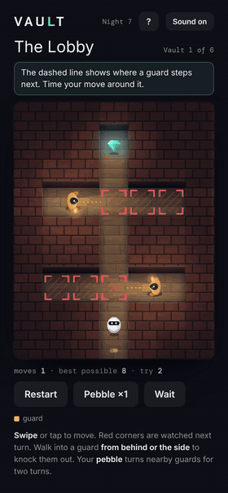

# VAULT

**A daily stealth puzzle for Reddit: crack tonight’s vaults, then build one that catches everyone else.**

Built with Devvit Web for Reddit’s Game of the Day hackathon.



Every night a new VAULT post goes up in the subreddit. You move one tile at a time; after each move the guards walk, lasers switch and cameras turn, and red corners show exactly what will be watched next. Every night there's one **Daily Vault**, the same for everyone, with a leaderboard for the fastest cracks and a spoiler-free line to share. Six training jobs teach the tricks (knockouts from behind, a pebble that turns guards, laser timing). Then you build your own vault from the same box of parts everyone got tonight. A solver makes sure it can be cracked, and the rest of the subreddit tries. The deadliest player vault is shown as **Deadliest tonight**; every crack or bust can be posted to the comments as a GIF.

- **The game:** [`vault-app/`](vault-app/) (how to play, how it works, how to run it)
- **Submission text:** [`docs/devpost.md`](docs/devpost.md)
- **Demo plan:** [`docs/demo-plan.md`](docs/demo-plan.md)
- **Early prototypes:** [`prototype/`](prototype/) (VAULT’s first version, plus two ideas we tried and set aside)

```bash
cd vault-app
npm install
npm test          # types, lint, unit and server tests, build
```
